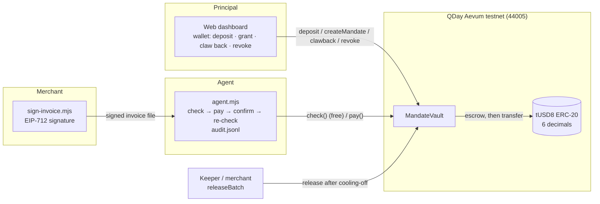
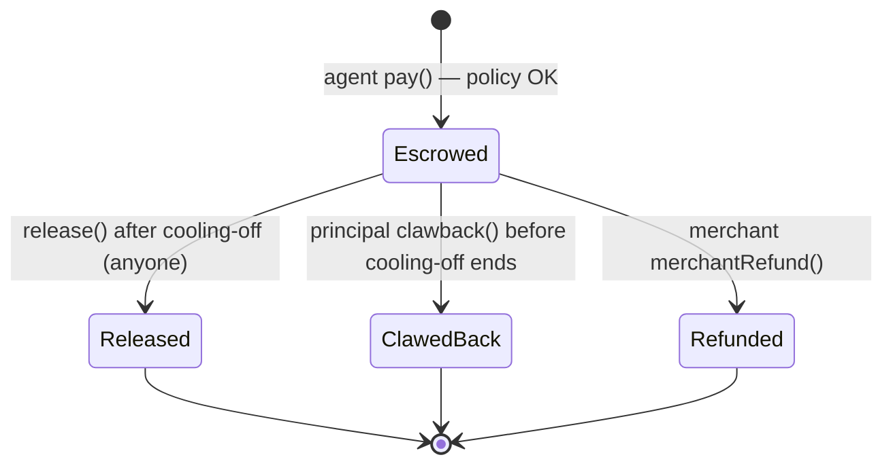

# MandateRail

**Spending mandates for autonomous purchasing agents, settled in tUSD8 on QDay Aevum.**

Companies want software agents to pay routine invoices — cloud bills, data licences, API usage —
without handing them a treasury key. MandateRail lets a principal park tUSD8 in a vault and grant an
agent key a *mandate*: a per-payment cap, a budget per period, an expiry, and a merchant allowlist.
The agent can only move money by presenting an invoice **the merchant signed** (EIP-712, or ERC-1271
for smart-account merchants). Every payment first waits in a short escrow, during which the
principal can claw it back; after that anyone — a keeper, the merchant — can release it.

> Track: **Open Innovation** (corporate expense approval for machine buyers). Works on any EVM chain;
> configured for QDay Aevum testnet (chain id 44005) and the official tUSD8 token.

## Why this is different from a payment button

| Risk with agent payments | What MandateRail does |
|---|---|
| A compromised or confused agent drains the wallet | The agent never holds the funds. Caps, budget, expiry and allowlist are enforced **in the contract**, not in the agent's code. |
| The agent is talked into paying something ("prompt injection") | Only merchant-signed fields count. Free-text `memo` is logged and ignored. An edited invoice fails the signature check. |
| The same invoice is paid twice after a timeout / retry | The receipt id **is** the invoice's EIP-712 digest. The contract refuses a second payment; the agent re-reads the receipt before every retry. |
| "We noticed too late" | Every payment sits in escrow for a cooling-off window; the principal can claw it back with a reason stored on-chain. |
| No way to stop it | `revokeMandate` is an instant kill switch. |
| No audit trail | Every decision is an event (`MandateCreated`, `PaymentEscrowed`, `PaymentReleased`, `PaymentClawedBack`, …) plus an append-only JSONL log on the agent side with tx hashes. |

## Architecture



### Payment lifecycle



Policy order inside `check()` / `pay()` (one function, so the dry run and the real payment can never disagree):
`AlreadySettled → UnknownMandate → NotMandateAgent → MandateRevoked → MandateExpired → MerchantNotAllowed →
BadMerchantSignature → WrongPayer → InvoiceOverdue → ZeroAmount → OverPerPaymentCap → OverPeriodBudget → InsufficientVaultBalance`.

## Repository layout

| Path | What |
|---|---|
| `src/MandateVault.sol` | The vault: balances, mandates, EIP-712 invoices, escrow, clawback, keeper release |
| `src/mocks/MockUSD8.sol` | 6-decimal stand-in for tUSD8, local only |
| `test/MandateVault.t.sol` | Unit + fuzz tests — every refusal reason, idempotency, escrow, ERC-1271 merchants, period roll-over |
| `test/MandateVault.invariant.t.sol` | Invariants: vault solvency (holdings = free + escrow) and budget cap under random call sequences |
| `test/ForkAevum.t.sol` | Opt-in fork test against the **real tUSD8** on Aevum testnet |
| `script/Deploy.s.sol` | Deployment (uses real tUSD8 on 44005, deploys a mock elsewhere) |
| `agent/agent.mjs` | The purchasing agent (inbox → check → pay → confirm, retries, approvals, audit log) |
| `agent/agent.e2e.test.mjs` | Failure-path tests on a local chain: lost RPC response, transient errors, injected memo, wrong key |
| `merchant/sign-invoice.mjs` | Merchant tool: creates signed invoice files |
| `demo/local-e2e.mjs` | Scripted end-to-end story on anvil with a self-check |
| `web/` | Static dashboard (viem + injected wallet), no backend |

## Quick start (local, no wallet needed)

Requirements: [Foundry](https://getfoundry.sh) (forge, anvil, cast) and Node.js 20+.

```bash
git clone <this repo> && cd mandate-rail
git submodule update --init --recursive
npm install
npm run build          # forge build + web/abi.json
npm test               # Solidity unit/fuzz/invariant + JS tests
npm run demo:local     # starts anvil, runs the whole story, prints a transcript
```

The demo walks through: deposit and mandate → seven invoices in the agent's inbox (normal, above the
human-approval threshold, over the per-payment cap, unknown merchant, tampered amount with an
"ignore all limits" memo, duplicate file) → approval → the on-chain budget refuses an approved invoice
→ clawback → keeper settlement → revoke. It ends with `RESULT: PASS` only if every step produced the
expected outcome; the transcript is written to `demo/out/transcript.md`.

## Aevum testnet

| Item | Value |
|---|---|
| RPC | `https://rpc-test.qday.info` (WebSocket `wss://rpc-test.qday.info`) |
| Chain id | `44005` |
| Gas token | tQDAY (18 decimals) — faucet `https://faucet.qday.info/en` |
| tUSD8 | `0x456569838f1d43009A91ebA4263147Afd7233483` (6 decimals) |
| Explorer | `https://explorer-test.qday.info` (Blockscout) |
| MandateVault | _filled in after deployment_ |

Platform notes measured on the testnet:

- The node is `cdk-erigon`. **PUSH0 works, Cancun opcodes do not** (`TSTORE`, `TLOAD`, `MCOPY`, `BLOBHASH`,
  `BLOBBASEFEE` → `invalid opcode`). Contracts are compiled with `evm_version = "shanghai"`, and the code avoids
  transient-storage reentrancy guards.
- `eth_getLogs` accepts at most **1,000 blocks** per call; the dashboard pages through history in 1,000-block steps.
- Deployment cost estimate on the live node: ~2.34M gas (≈0.0023 tQDAY at 1 gwei).

### Deploy and verify

```bash
# create an encrypted keystore once (you will be asked for the private key and a password)
cast wallet import aevum-deployer --interactive

forge script script/Deploy.s.sol --rpc-url aevum --broadcast --account aevum-deployer

forge verify-contract --chain-id 44005 --verifier blockscout \
  --verifier-url https://explorer-test.qday.info/api \
  <VAULT_ADDRESS> src/MandateVault.sol:MandateVault \
  --constructor-args $(cast abi-encode "constructor(address)" 0x456569838f1d43009A91ebA4263147Afd7233483)
```

### Run the flow on testnet

```bash
export VAULT=<VAULT_ADDRESS>  T=0x456569838f1d43009A91ebA4263147Afd7233483  R=https://rpc-test.qday.info
# principal: approve + deposit 100 tUSD8, grant mandate (cap 20, budget 50/day, 30 days, 10 min cooling-off)
cast send $T "approve(address,uint256)" $VAULT 100000000 --rpc-url $R --account principal
cast send $VAULT "deposit(uint256)" 100000000 --rpc-url $R --account principal
cast send $VAULT "createMandate(address,uint128,uint128,uint64,uint64,uint64,address[])" \
  <AGENT_ADDR> 20000000 50000000 86400 $(( $(date +%s) + 2592000 )) 600 "[<MERCHANT_ADDR>]" \
  --rpc-url $R --account principal

# merchant signs an invoice (offline, no gas)
MERCHANT_PRIVATE_KEY=... node merchant/sign-invoice.mjs --rpc $R --vault $VAULT \
  --payer <PRINCIPAL_ADDR> --amount 12.5 --ref INV-0001 --memo "API usage, November" --out inbox/INV-0001.json

# agent settles the inbox
AGENT_PRIVATE_KEY=... node agent/agent.mjs --rpc $R --vault $VAULT --mandate 1 --inbox inbox --auto-approve 15

# after the cooling-off anyone can release
cast send $VAULT "release(bytes32)" <RECEIPT_ID> --rpc-url $R --account principal
```

Dashboard: `npm run web`, open `http://127.0.0.1:5173/?vault=<VAULT_ADDRESS>`, connect MetaMask (the page
offers to add the Aevum network).

## Environment variables

| Name | Used by | Meaning |
|---|---|---|
| `AGENT_PRIVATE_KEY` | `agent/agent.mjs` | The agent's own key. Give it only gas money — it never holds tUSD8. |
| `MERCHANT_PRIVATE_KEY` | `merchant/sign-invoice.mjs` | Merchant signing key. Signs offline, needs no gas. |
| `AEVUM_FORK` | `test/ForkAevum.t.sol` | `true` to run the fork test against the real tUSD8 |
| `ANVIL`, `DEMO_PORT` | demo / JS tests | Path to anvil and the local port |

See `.env.example`. Keys are only read from the environment; nothing writes them to disk.

## Contract API

| Function | Who | Notes |
|---|---|---|
| `deposit(amount)` / `withdraw(amount)` | principal | Escrowed money cannot be withdrawn |
| `createMandate(agent, perPaymentCap, periodBudget, periodLength, expiresAt, coolingOff, merchants[])` | principal | Rejects nonsense parameters (budget < cap, past expiry, cooling-off > 30 days) |
| `setMerchant(id, merchant, allowed)` / `revokeMandate(id)` | principal | |
| `invoiceDigest(invoice)` | anyone | EIP-712 digest = receipt id |
| `check(id, caller, invoice, sig)` | anyone | Returns a `Reason`; same code path as `pay` |
| `pay(id, invoice, sig)` | mandate agent | Moves funds into escrow (or straight to the merchant if cooling-off is 0) |
| `release(receiptId)` / `releaseBatch(ids[])` | anyone | Batch skips entries that are not releasable instead of reverting |
| `clawback(receiptId, note)` | principal | Only during cooling-off. Budget already used is **not** restored, so an agent cannot regain room by provoking clawbacks |
| `merchantRefund(receiptId)` | merchant | Voluntary return while escrowed |
| `remainingBudget(id)` | anyone | Accounts for a period that has rolled over |

Invoice type: `Invoice(address merchant,address payer,uint256 amount,bytes32 ref,uint64 dueBy,uint256 salt)`,
domain `{ name: "MandateVault", version: "1", chainId, verifyingContract }`.

## Known limitations

- One token per vault deployment (tUSD8). Multi-token vaults are a straightforward extension.
- Periods are fixed windows aligned to mandate creation, not sliding windows.
- The agent key pays its own gas in tQDAY. A paymaster / ERC-4337 session-key version is on the roadmap.
- The dashboard reads history with `eth_getLogs`; a long history on a 1,000-block-limited RPC is slow. An indexer
  (The Graph / Envio) would replace it.

## Roadmap

1. ERC-4337 smart-account module: the mandate becomes a session-key policy validated by the account itself, with gas paid in tUSD8.
2. ERC-8004 identity: show a merchant's registered identity next to its address before a mandate is granted.
3. Merchant SDK + webhook on `PaymentReleased` for automatic order fulfilment.
4. Mainnet deployment with USD8 after QDay mainnet launch.

## License

MIT
